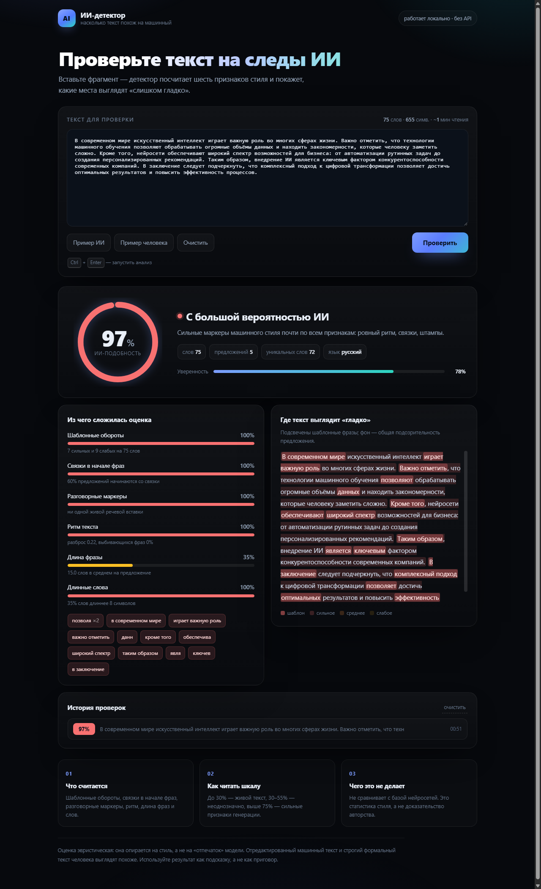

# ИИ-детектор текста

Простой статический сайт: вставляете текст — получаете оценку в процентах,
насколько он похож на сгенерированный нейросетью. Без сервера, без API-ключей,
без сборки.



## Запуск

Вариант 1 — просто открыть файл:

```
ai-detector/index.html
```

Вариант 2 — через локальный сервер (если файл не открывается двойным кликом):

```powershell
cd D:\MyProgram\ai-detector
python -m http.server 8000
```

и зайти на <http://localhost:8000>.

## Что внутри

| Файл | Назначение |
|------|------------|
| `index.html` | разметка страницы |
| `style.css` | оформление (тёмная тема, адаптив) |
| `detector.js` | сам анализ: 6 признаков + словари маркеров |
| `app.js` | интерфейс: ввод, отрисовка результата, история |
| `selftest.js` | проверка калибровки на примерах (`node selftest.js`) |

## Как считается оценка

Каждый признак переводится в число 0..1 (1 = «как у ИИ») и складывается с весом:

| Признак | Вес | Логика |
|---------|-----|--------|
| Шаблонные обороты | 0.28 | фразы вроде «важно отметить», «в современном мире», «играет важную роль» |
| Связки в начале фраз | 0.19 | доля предложений, начинающихся с «однако», «таким образом», «кроме того» |
| Разговорные маркеры | 0.17 | «блин», «короче», «лол», восклицания, смайлы — снижают оценку |
| Ритм текста | 0.17 | однородные по длине предложения без «выбивающихся» фраз |
| Длина фразы | 0.09 | длинные ровные предложения — типично для моделей |
| Длинные слова | 0.10 | доля слов длиннее 8 символов |

Итог: `percent = (сумма − 0.10) / 0.85`, обрезается в 0..97.
Шкала: **до 30%** — человек, **30–55%** — неоднозначно, **55–75%** — похоже на ИИ,
**выше 75%** — сильные признаки генерации.

Дополнительно показываются: уверенность (зависит от длины текста и согласованности
признаков), разметка предложений и список найденных штампов.

## Важно

Это **эвристика по стилю, а не детектор по «отпечатку» модели**. Она не сравнивает
текст с базой генераций и не может служить доказательством авторства.

- Отредактированный машинный текст она часто считает человеческим.
- Строгий формальный текст человека (договор, статья, инструкция) может получить 50–60%.
- Короткие тексты (меньше ~40 слов) — низкая уверенность, результат почти случайный.

## Проверка

```powershell
cd D:\MyProgram\ai-detector
node selftest.js
```

Ожидаемо: пример ИИ — выше 90%, пример человека — ниже 15%,
формальный текст — в районе 50%, слишком короткий текст не анализируется.
